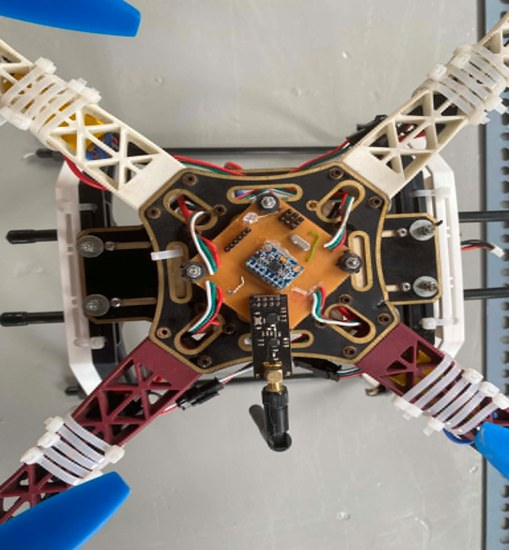
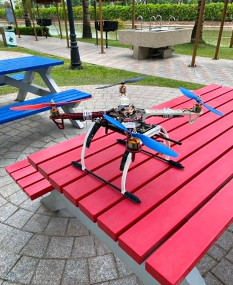
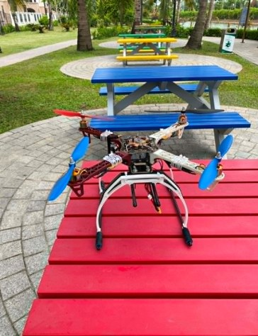

# Drone Quadcopter VVT

Hệ thống điều khiển quadcopter gồm 3 phần, đi theo chiều dữ liệu:

```
[WPF trên PC] --UART 9600--> [Bộ phát RF (PIC16 + nRF24L01)] --2.4GHz--> [Drone (PIC18F45K22 + nRF24L01)]
      ^                                                                           |
      +------------------------- telemetry (ACK payload) <------------------------+
```

Toàn bộ hệ thống do mình tự thiết kế và thực hiện: mạch điều khiển bay, firmware, bộ phát RF và phần mềm giám sát trên máy tính.

> **Phiên bản:** firmware trong repo là **v2** (lọc Kalman thích nghi, đọc FIFO 250 Hz, failsafe nhiều lớp, telemetry trạng thái). Video bay thử và số liệu thực nghiệm bên dưới được đo trên phiên bản **v1** của cùng phần cứng; v2 đang trong giai đoạn hiệu chỉnh.

## Cấu trúc thư mục

| Thư mục | Vai trò | Phần cứng / công nghệ |
|---|---|---|
| `1_drone_PIC18F45K22/` | Firmware drone: đọc MPU6050, lọc Kalman, PID attitude, xuất PWM 4 motor, failsafe | PIC18F45K22 @ 64 MHz (XC8), MPU6050 (I2C), nRF24L01 (SPI, chế độ RX) |
| `2_rf_transmitter_PIC16/` | Cầu nối UART <-> RF: nhận khung lệnh từ PC, gửi qua nRF, trả telemetry về PC | PIC16 (HS 16 MHz, XC8), nRF24L01 (chế độ TX) |
| `3_wpf_ground_station/` | Giao diện điều khiển và đồ thị thời gian thực trên PC | WPF (.NET), LiveCharts, SerialPort |

## Giao thức

Dùng chung kênh RF 0x40 (64), 2 Mbps, địa chỉ `E7 E7 E7 E7 E7`, Auto-ACK + Dynamic Payload + ACK payload.

**PC -> bộ phát (UART 9600, 15 byte):** `0xCC 0xDD` + 13 byte lệnh

| Byte | Trường |
|---|---|
| 0 | speed (ga, 0-100) |
| 1-2 | roll_ref (int16, độ x 100) |
| 3-4 | pitch_ref (int16, độ x 100) |
| 5 | Rate_ref (int8, tốc độ yaw mong muốn) |
| 6 | Turn: bit0 = chạy/dừng, bit1 = reset PID/motor (cũng dùng cho nút ZW SET) |
| 7-9 | kp / ki / kd góc |
| 10-12 | kp / ki / kd yaw |

**Drone -> PC (qua ACK payload, bộ phát gửi lên UART với header `0xAA 0xBB`, 11 byte):**

| Byte | Trường |
|---|---|
| 0-1 | roll (int16, độ x 100) |
| 2-3 | pitch (int16, độ x 100) |
| 4-5 | rate_x (int16, x 10) |
| 6-7 | rate_y (int16, x 10) |
| 8-9 | rate_z / yaw (int16, x 10) |
| 10 | state: bit0 = đang chạy, bit1 = khóa khẩn cấp (latch), bit2-3 = nguyên nhân ngắt (1 mất sóng, 2 mất MPU, 3 nghiêng quá 60 độ), bit4-5 = nguyên nhân reset (1 WDT, 2 BOR) |

Bộ phát gửi `0xEE` lên PC mỗi 500 ms nếu không thấy module nRF.

## Phần cứng

| Khối | Lựa chọn | Ghi chú |
|---|---|---|
| Khung | F450 (chữ X, 450 mm), sợi thủy tinh + nhựa PA66, càng đáp nhựa/carbon | Cánh tay đòn hấp thụ rung động |
| Động cơ | A2212 1000 KV (không chổi than) | Công suất cực đại 150 W, 52.7 g |
| Cánh quạt | 1045 (10 inch, bước 4.5 inch), thuận/nghịch | Tốc độ tối đa thực tế khoảng 8400 vòng/phút |
| ESC | 30 A, BEC 5 V 2 A | Cấp nguồn 5 V cho mạch điều khiển |
| Nguồn | LiPo 3S 5200 mAh 50C | 11.1 V danh định, 12.6 V đầy |
| Vi điều khiển | PIC18F45K22 @ 64 MHz | I2C cho IMU, SPI cho RF, 4 kênh CCP |
| IMU | MPU6050 (I2C) | Gia tốc ±8 g, gyro ±500 °/s |
| RF | nRF24L01 + PA + LNA, ăng-ten rời | 2.4 GHz, công suất tối đa +20 dBm |

Kiểm tra lực nâng khi chọn động cơ: lực đẩy tối đa tính được khoảng 32.8 N so với trọng lượng toàn hệ thống khoảng 10 N, tức lớn hơn 3 lần (yêu cầu thiết kế là lớn hơn 2 lần).

## Thuật toán (theo firmware trong repo)

- **Tính góc nghiêng:** MPU6050 lấy mẫu 1 kHz, MCU đọc FIFO và trung bình 4 mẫu thành 250 Hz. Gia tốc kế cho góc tuyệt đối nhưng nhiễu rung, gyro cho phản hồi nhanh nhưng trôi theo thời gian, hai nguồn được hợp nhất bằng **bộ lọc Kalman thích nghi**: phương sai đo R tăng khi rung hoặc có gia tốc ngoài trọng lực, nên lúc đó bộ lọc tin gyro nhiều hơn.
- **Điều khiển Roll / Pitch:** `output = (Kp·e + Ki·∫e + Kd·rate) / 5`, trong đó `e` là sai số góc, `rate` là tốc độ góc đo từ gyro (thành phần D lấy trực tiếp từ gyro nên ít nhiễu hơn đạo hàm sai số).
- **Điều khiển Yaw:** `output = (Kp·e + Ki·∫e + Kd·de/dt) / 10`, trong đó `e` là sai số tốc độ góc.
- **Chống bão hòa tích phân:** chỉ tích lũy Ki khi ga đủ lớn, kẹp tích phân ±600, kẹp đầu ra PID ±800.
- **Mixer:** trộn 4 đầu ra (ga, roll, pitch, yaw) thành xung PWM cho 4 ESC (1000 - 2000 µs).
- **Failsafe:** ngắt khẩn cấp khi mất sóng RF (500 ms), mất mẫu MPU (50 ms) hoặc nghiêng quá 60°. Nguyên nhân được gửi về PC trong telemetry.
- **Phần mềm giám sát:** ứng dụng WPF kết nối qua cổng COM, hiển thị góc, tốc độ góc và đồ thị theo thời gian thực, gửi lệnh ga/hướng và chỉnh hệ số PID.

## Hệ số PID

Mỗi hệ số PID là **1 byte (0 - 255)** nhập từ giao diện WPF. Do firmware chia hệ số trong `pid()` (chia 5 cho góc, chia 10 cho yaw), giá trị nhập vào bằng hệ số thực nhân 5 (góc) hoặc nhân 10 (yaw), độ phân giải lần lượt là 0.2 và 0.1.

Giá trị bắt đầu lấy từ kết quả dò PID trên khung treo tự do ở phiên bản v1 (phương pháp Ziegler-Nichols kết hợp chỉnh tay):

| Trục | Hệ số | Giá trị thực | **Nhập vào WPF (code mới)** |
|---|---|---|---|
| Roll / Pitch (góc) | Kp | 3.8 | **19** |
| | Ki | 0.8 | **4** |
| | Kd | 0.65 | **3** (3.25 làm tròn, tương đương 0.6) |
| Yaw (tốc độ góc) | Kp | 1 | **10** |
| | Ki | 0.0 | **0** (0.2 làm tròn xuống, bước nhỏ nhất của thang là 0.1) |
| | Kd | 0.0 | **0** (0.5, bước nhỏ nhất của thang là 0.1) |

Ghi chú:
- Ở v1, khâu I của Roll/Pitch ban đầu bị khóa (Ki = 0) vì nhiễu rung động cơ gây bão hòa tích phân, sau đó mới chỉnh lại Ki = 0.8.
- Ki và Kd của yaw nhỏ hơn bước nhỏ nhất của thang chia 10 nên để 0, lúc đầu yaw chỉ chạy thành phần P. Nếu yaw trôi hoặc dao động thì tăng dần Ki hoặc Kd từng bước 1 (tương đương 0.1). Muốn dùng đúng giá trị 0.02 và 0.05 thì cần đổi hệ số chia riêng cho hai hệ số này trong code (ví dụ chia 100).
- Đây là điểm bắt đầu để dò lại, vì firmware mới đã đổi bộ lọc (Kalman thích nghi, 250 Hz), cách tính đạo hàm và mixer. Nên dò lại trên khung treo tự do, không bay tự do ngay.

## Thực nghiệm (firmware v1)

**Bay thử:** trong không gian có tường che, trải thảm xốp giảm chấn. Drone cất cánh thẳng đứng, lên độ cao khoảng 0.5 - 0.8 m và lơ lửng ổn định, đáp ứng các lệnh tiến, lùi, trái, phải, quay hướng từ máy tính.

| Chỉ tiêu | Kết quả |
|---|---|
| Thời gian bay | Ước tính 16 - 20 phút (dòng tiêu thụ khi bay treo khoảng 12 - 15 A, pin 5200 mAh) |
| Tải trọng dư | Giữ được bay treo ổn định với tải thêm 1 kg |
| Kháng nhiễu | Giảm nhanh dao động khi bị tác động ngoại lực hoặc gió tạt, góc hội tụ về 0° |

**Hạn chế đã ghi nhận:** còn trôi nhẹ do cơ khí, cảm biến chưa nằm đồng phẳng với mặt phẳng cánh và còn nhiễu, dòng xả pin chưa tối ưu khi tăng ga đột ngột nên động cơ và ESC nóng.

**Hướng phát triển:** thêm cảm biến độ cao (MS5611 hoặc siêu âm) để giữ độ cao, GPS kết hợp Optical Flow để giữ vị trí ngoài trời, thử bộ điều khiển hiện đại như MPC.

## Hình ảnh sản phẩm

**Mạch điều khiển nhìn từ trên xuống:** mạch tự làm đặt giữa khung, gồm cảm biến MPU6050 (bo xanh) và module nRF24L01 có ăng-ten rời.



**Drone hoàn chỉnh (quadcopter, khung X, chân đáp):**




## Cách build

- **Drone / Bộ phát:** mở bằng MPLAB X, tạo project mới với đúng chip, thêm các file `.c` / `.h` trong thư mục tương ứng, biên dịch bằng XC8. Hai thư mục đều có `NRF.*` và `SPI.*` riêng (khác nhau), **không** thêm chung vào một project.
- **WPF:** tạo project WPF (namespace `drone_control`), thay `MainWindow.xaml` và `MainWindow.xaml.cs` bằng hai file trong thư mục này, cài NuGet `LiveCharts.Wpf`.

## Lưu ý an toàn

Khi test mixer và PID, luôn tháo cánh quạt. Kiểm tra dấu mixer khớp vị trí và chiều quay motor thực tế.
